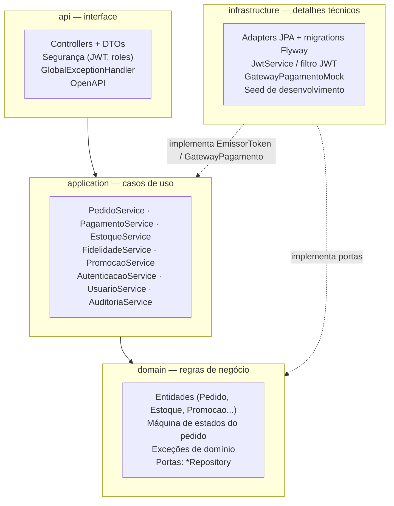
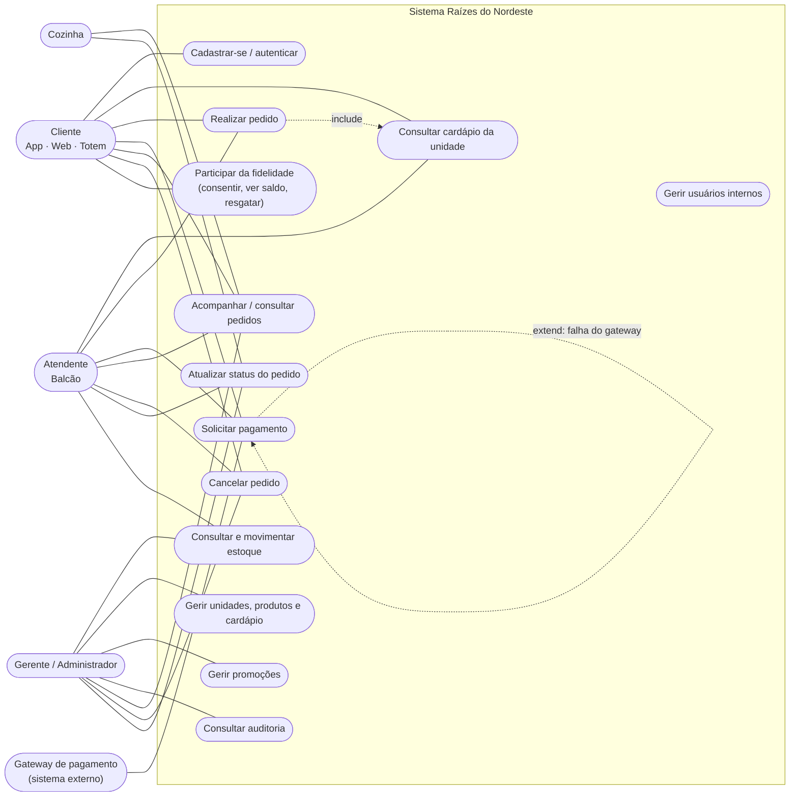
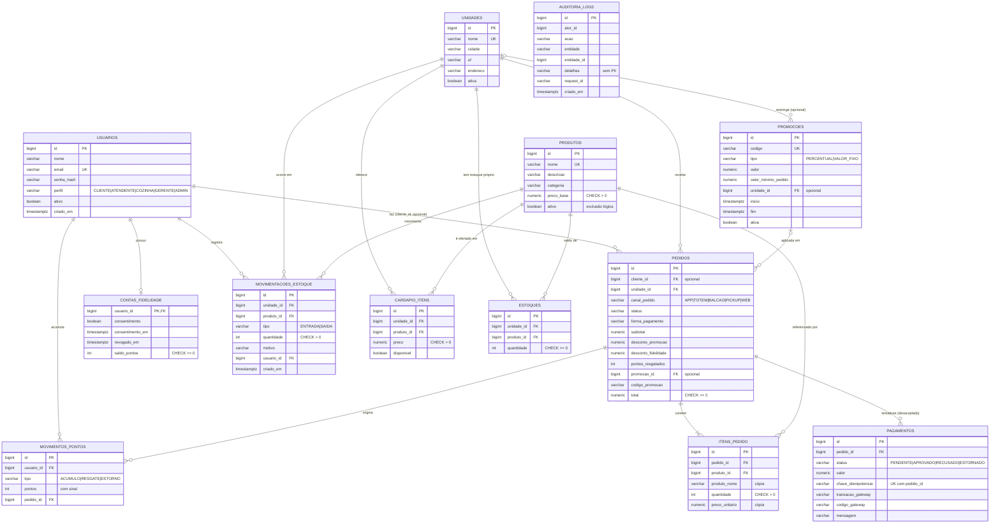
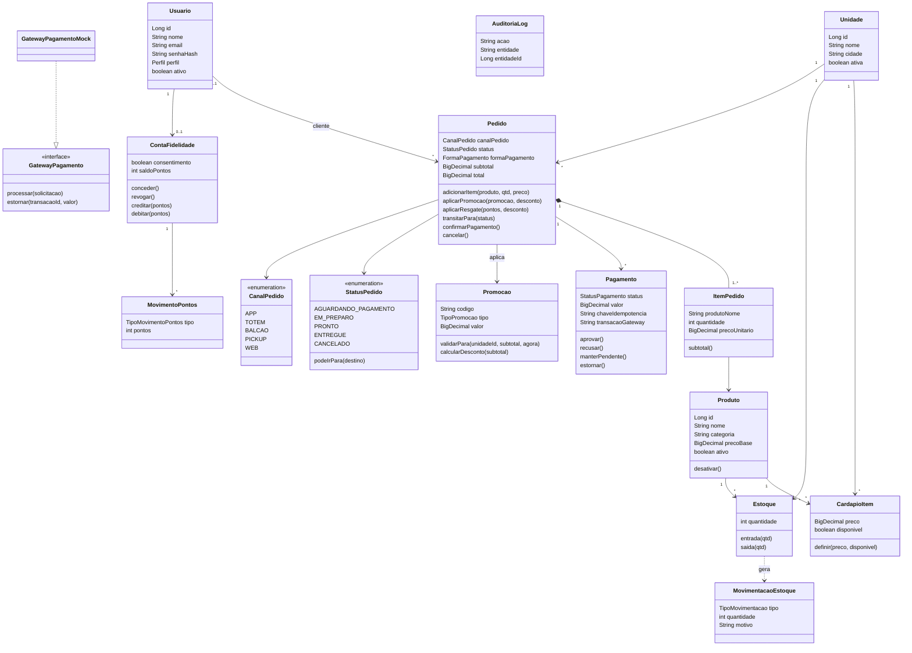
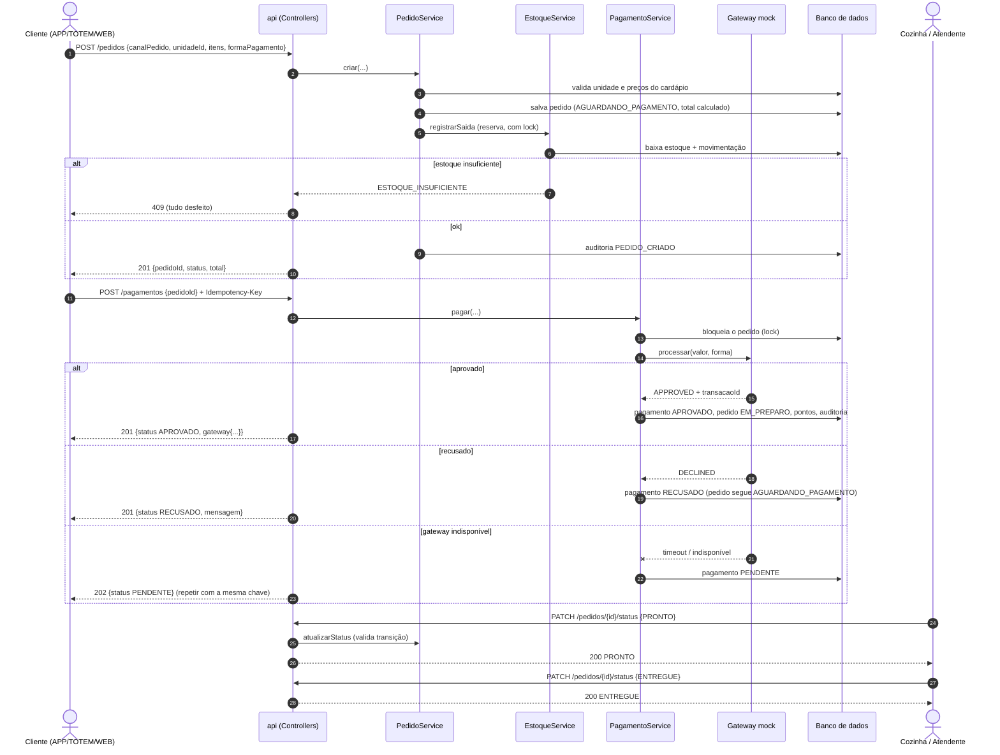
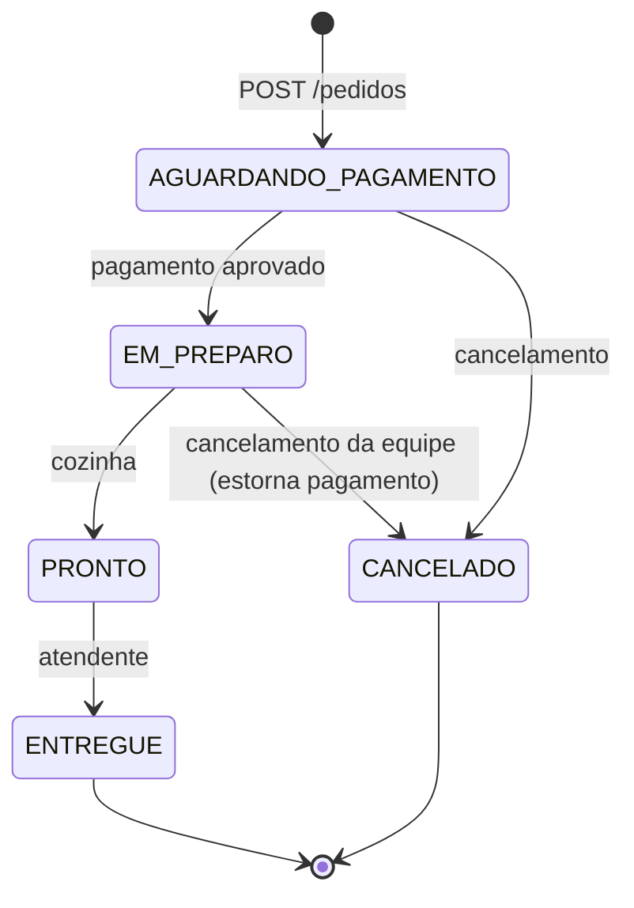

# Arquitetura e diagramas

Os diagramas estão em [Mermaid](https://mermaid.js.org/) e são renderizados automaticamente pelo GitHub/GitLab. Para obter imagem ou PDF (ex.: para o relatório), cole o bloco em https://mermaid.live e exporte.

## 1. Arquitetura em camadas

| Camada | Responsabilidade | Exemplos |
|---|---|---|
| **api** | Rotas, contratos request/response, validação de entrada, autenticação/autorização, mapeamento de exceções para o padrão de erro, Swagger | `PedidoController`, `GlobalExceptionHandler`, `SecurityConfig` |
| **application** | Orquestra o caso de uso e a transação; não conhece HTTP | `PedidoService.criar`, `PagamentoService.pagar` |
| **domain** | Entidades, validações e comportamentos (ex.: `Estoque.saida`, `Pedido.transitarPara`, `Promocao.validarPara`); define as portas de persistência | `Pedido`, `StatusPedido.podeIrPara` |
| **infrastructure** | Persistência (JPA), integrações (gateway mock), JWT e seed | `PedidoRepositoryAdapter`, `GatewayPagamentoMock` |

Sentido das dependências: `api → application → domain`. A infraestrutura implementa interfaces definidas no domínio/aplicação (inversão de dependência), por isso trocar o gateway mock por um real não afeta as regras.

## 2. Diagrama de casos de uso

### Descrição da feature crítica — UC03/UC04: Realizar pedido + Solicitar pagamento

| Item | Descrição |
|---|---|
| **Atores** | Principal: Cliente (ou Atendente no balcão). Secundário: Gateway de pagamento (mock) |
| **Pré-condições** | Usuário autenticado (CLIENTE, ATENDENTE, GERENTE ou ADMIN); unidade ativa; produtos ofertados e disponíveis no cardápio da unidade; saldo de estoque suficiente |
| **Pós-condições (sucesso)** | Pedido persistido com itens, valores e `canalPedido`; estoque reservado; pagamento registrado; pedido `EM_PREPARO`; pontos de fidelidade acumulados (se houver consentimento); ações auditadas |

**Fluxo principal**

1. O ator envia `POST /pedidos` com `canalPedido`, `unidadeId`, itens e `formaPagamento` (opcionalmente `codigoPromocao` e `pontosResgatar`).
2. O sistema valida os campos, a unidade e o cliente.
3. O sistema resolve cada item no cardápio da unidade e obtém o preço vigente.
4. O sistema calcula o total (subtotal − promoção − resgate de pontos) e grava o pedido com status `AGUARDANDO_PAGAMENTO`.
5. O sistema baixa o estoque de cada item (com bloqueio) e grava a auditoria `PEDIDO_CRIADO`. Responde `201`.
6. O ator envia `POST /pagamentos` com o `pedidoId` (e o header `Idempotency-Key`).
7. O sistema bloqueia o pedido, envia a solicitação ao gateway mock e recebe status e payload.
8. Pagamento **aprovado**: o sistema registra o pagamento, move o pedido para `EM_PREPARO`, acumula pontos e audita. Responde `201` com `status=APROVADO` e o retorno do gateway.
9. A cozinha marca `PRONTO` e o atendente marca `ENTREGUE` (`PATCH /pedidos/{id}/status`).

**Fluxos alternativos e exceções**

| Situação | Tratamento | Resposta |
|---|---|---|
| `canalPedido` ausente / valor fora do enum | Rejeita antes de qualquer efeito | 422 / 400 |
| Quantidade ≤ 0, lista de itens vazia | Rejeita | 422 |
| Unidade ou produto inexistente | Rejeita | 404 |
| Produto fora do cardápio ou indisponível; unidade inativa | Rejeita | 409 `PRODUTO_INDISPONIVEL` / `UNIDADE_INATIVA` |
| Estoque insuficiente | Desfaz tudo (nenhuma baixa parcial) | 409 `ESTOQUE_INSUFICIENTE` (`itens[i].quantidade`) |
| Promoção inválida/expirada; pontos insuficientes ou sem consentimento | Desfaz tudo | 409 / 404 |
| Pagamento **recusado** | Registra a tentativa `RECUSADO`; pedido permanece `AGUARDANDO_PAGAMENTO`; cliente pode tentar de novo ou cancelar | 201 `status=RECUSADO` |
| Gateway **indisponível** | Registra `PENDENTE`; pedido não é perdido; repetir com a mesma `Idempotency-Key` | 202 `status=PENDENTE` |
| Requisição repetida (mesma `Idempotency-Key`) | Devolve o resultado original, sem nova cobrança | 200 |
| Pedido já pago / cancelado | Rejeita | 409 `PEDIDO_NAO_PAGAVEL` |
| Pagamentos simultâneos do mesmo pedido | Serializados por lock; só um aprova | 409 para os demais |

**Regras de negócio:** idempotência do pagamento; total sempre calculado no servidor; reserva de estoque atômica; transições de status validadas; CLIENTE só acessa os próprios pedidos (404 nos alheios).

## 3. Modelo de dados (DER)

Observações de modelagem:

- **Estoque por unidade:** `estoques` tem chave única (`unidade_id`, `produto_id`); o saldo nunca fica negativo (`CHECK`). Toda alteração gera uma linha em `movimentacoes_estoque` (livro de movimentações).
- **Pagamento desacoplado:** `pagamentos` é uma tabela própria; um pedido pode ter várias tentativas (ex.: recusado e depois aprovado). A chave (`pedido_id`, `chave_idempotencia`) é única.
- **Histórico imutável:** `itens_pedido` copia nome e preço do produto; `pedidos.codigo_promocao` copia o código usado.
- **Integridade:** chaves estrangeiras e `CHECK` nas migrations Flyway (`src/main/resources/db/migration`); o Hibernate roda com `ddl-auto=validate`, garantindo que modelo e implementação coincidem.
- `auditoria_logs` não tem chaves estrangeiras de propósito: é um registro histórico que deve sobreviver a qualquer alteração dos dados.

## 4. Diagrama de classes (visão de domínio)

## 5. Diagrama de sequência — Pedido → Pagamento externo (mock) → Status

## 6. Máquina de estados do pedido

