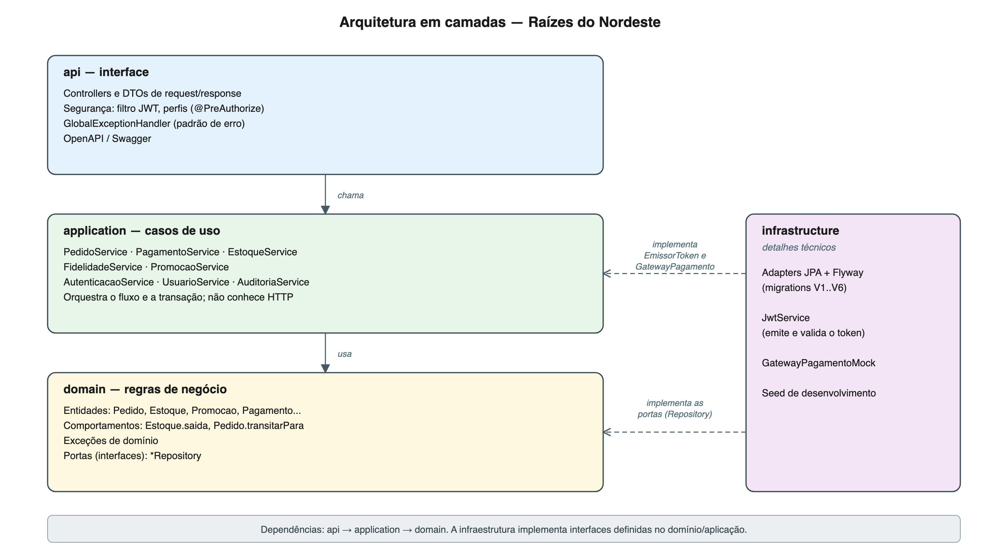
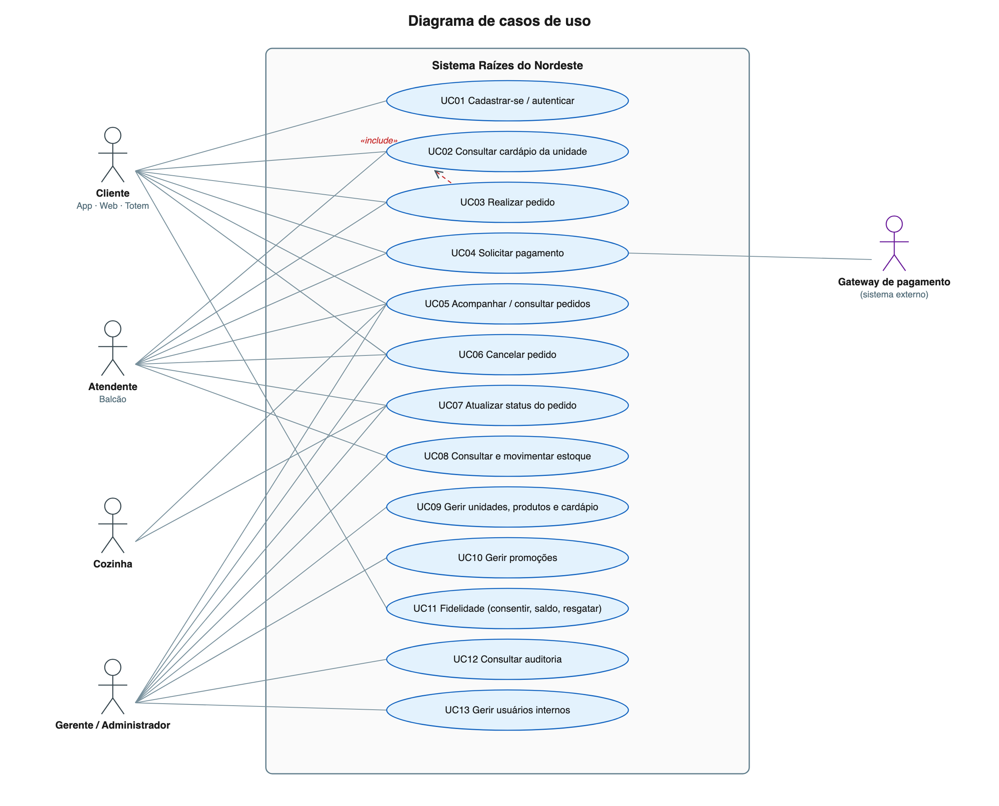
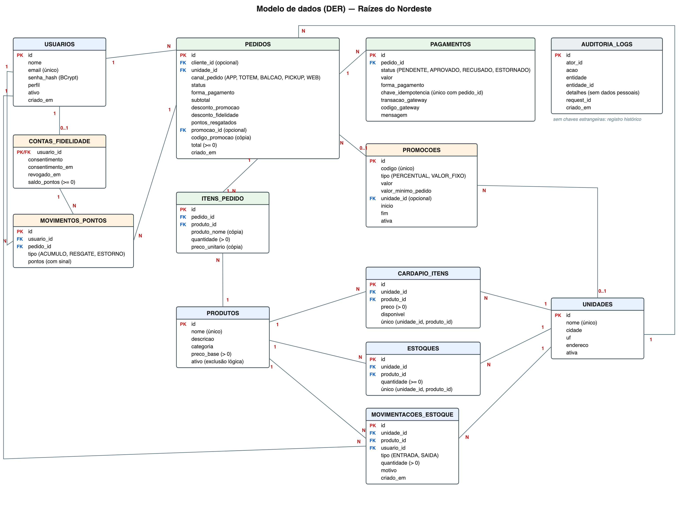
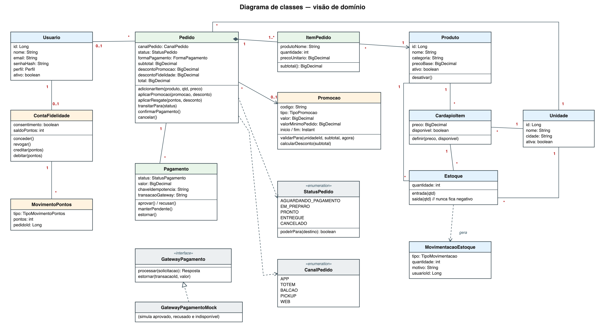
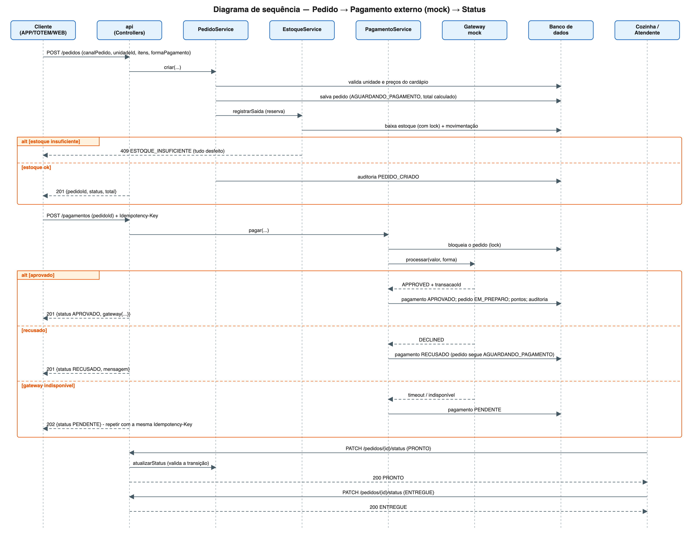
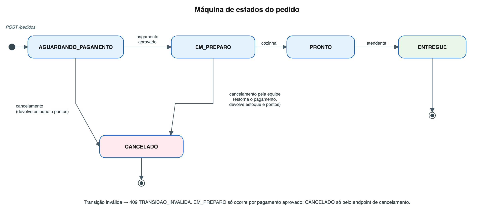

# RELATÓRIO DO PROJETO DE BACK-END — RAÍZES DO NORDESTE

> **Texto-base para o relatório final.** Reúne o conteúdo de `docs/` em um único arquivo para ser convertido/colado no modelo ABNT exigido (capa, sumário, numeração, referências e entrega em PDF nomeado `RU_Projeto_Back_End.PDF`). Os diagramas estão como imagens em `docs/diagramas/` (PNG e SVG) e já referenciados abaixo.

**Capa:** _instituição, curso, disciplina, nome do aluno, RU, professor, cidade e ano_.

---


## 1 INTRODUÇÃO E OBJETIVOS

A **Raízes do Nordeste** é uma rede de restaurantes de culinária nordestina que atende clientes por vários canais (aplicativo, totem de autoatendimento, balcão, retirada e web) em diferentes unidades. Cada unidade tem cardápio, preços e estoque próprios, e a operação precisa de rastreabilidade do pedido da origem até a entrega.

Este trabalho apresenta a análise do caso, a modelagem de dados e a implementação de um **back-end REST** que sustenta esse cenário, com foco no fluxo crítico **Pedido → Pagamento (simulado) → Atualização de status**.

**Objetivo geral:** entregar uma API executável, documentada e testável que demonstre os elementos de um back-end profissional.

**Objetivos específicos:**

- levantar e priorizar requisitos funcionais e não funcionais (seção 2);
- modelar o domínio e o banco de dados e organizar o código em camadas (seção 3);
- definir e documentar o contrato da API em OpenAPI/Swagger (seção 4);
- aplicar segurança e LGPD no nível técnico mínimo (seção 5);
- comprovar o funcionamento com plano de testes reprodutível (seção 7).

**Tecnologias:** Java 17, Spring Boot 4, Spring Web MVC, Spring Data JPA/Hibernate, Spring Security (JWT), Flyway, springdoc-openapi, H2 (desenvolvimento e testes) e PostgreSQL (produção), JUnit/MockMvc e Postman.


## 2 ANÁLISE E REQUISITOS

Levantamento com foco em regras de negócio, persistência, integrações e segurança (não em telas). Prioridade pelo método MoSCoW: **Must** (essencial ao fluxo crítico), **Should** (importante), **Could** (desejável).

### 2.1 Requisitos funcionais

| ID | Requisito | Prioridade | Por quê | Situação | Endpoints |
|---|---|---|---|---|---|
| RF01 | Cadastro de usuários e autenticação (login) com perfis/roles | Must | Sem identidade não há controle de acesso nem rastreabilidade | Implementado | `/auth/login`, `/usuarios`, `/usuarios/internos`, `/usuarios/me` |
| RF02 | Gestão de unidades da rede | Must | Estoque, cardápio e pedidos são por unidade | Implementado | `/unidades` |
| RF03 | Produtos e cardápio por unidade (preço e disponibilidade próprios) | Must | O pedido precisa de preço vigente na unidade | Implementado | `/produtos`, `/unidades/{id}/cardapio` |
| RF04 | Pedido com itens, valores e status; canal de origem obrigatório (`canalPedido`) | Must | É o fluxo crítico do negócio e a base da multicanalidade | Implementado | `POST /pedidos` |
| RF05 | Consulta/filtro de pedidos (por canal, status, unidade) | Must | Acompanhamento operacional entre canais | Implementado | `GET /pedidos?canalPedido=` |
| RF06 | Atualização de status (cozinha → pronto → entregue) e cancelamento | Must | Operação da cozinha e do atendimento | Implementado | `PATCH /pedidos/{id}/status`, `POST /pedidos/{id}/cancelamento` |
| RF07 | Controle de estoque por unidade (entrada/saída) e restrição de venda sem saldo | Must | Evita vender o que não existe | Implementado | `/estoque` |
| RF08 | Pagamento via serviço externo (mock) com registro, status e payload de retorno | Must | Fecha o fluxo crítico sem depender de provedor real | Implementado | `/pagamentos` |
| RF09 | Programa de fidelidade (pontos, saldo, histórico, resgate) com consentimento | Should | Retenção de clientes; exige base legal (LGPD) | Implementado | `/fidelidade` |
| RF10 | Promoções/campanhas aplicáveis por código | Should | Regra comercial do cenário | Implementado | `/promocoes`, `codigoPromocao` no pedido |
| RF11 | Auditoria de ações sensíveis | Should | Rastreabilidade e responsabilização | Implementado | `/auditoria` |
| RF12 | Refresh token e logout | Could | Conforto de sessão; JWT de curta duração já atende o MVP | **Não implementado** | — |

### 2.2 Multicanalidade

`canalPedido` ∈ {`APP`, `TOTEM`, `BALCAO`, `PICKUP`, `WEB`}. É obrigatório na criação (ausente → 422; valor inválido → 400), fica gravado no pedido e pode ser usado como filtro (`GET /pedidos?canalPedido=TOTEM`).

### 2.3 Requisitos não funcionais

| ID | Requisito | Como foi atendido |
|---|---|---|
| RNF01 | Segurança: autenticação por token e autorização por perfil | JWT (HS256) stateless; `@PreAuthorize` por rota; 401/403 no padrão de erro |
| RNF02 | Senha com hash | BCrypt; o hash nunca é retornado |
| RNF03 | LGPD: minimização e consentimento | Fidelidade só com consentimento (revogável); respostas sem dados desnecessários; auditoria e logs sem e-mail/nome; CLIENTE só vê os próprios pedidos |
| RNF04 | Logs/auditoria de ações sensíveis | Tabela `auditoria_logs` gravada na mesma transação da ação, com `requestId` |
| RNF05 | Desempenho em horários de pico | Paginação em listagens, índices nos filtros, consultas com fetch join, lock pessimista curto só onde há disputa (estoque, pedido, conta de pontos) |
| RNF06 | Consistência sob concorrência | Saídas de estoque e pagamentos simultâneos são serializados por lock; testes automatizados comprovam (10 saídas concorrentes de 1 un. sobre saldo 5 → exatamente 5 sucessos; 6 pagamentos simultâneos → 1 aprovado) |
| RNF07 | Tolerância a falhas na integração de pagamento | Gateway indisponível gera pagamento `PENDENTE` (202) sem perder o pedido; repetição com a mesma `Idempotency-Key` conclui sem cobrar em duplicidade |
| RNF08 | Documentação | OpenAPI/Swagger gerado do código + documentos em `docs/` |
| RNF09 | Erro padronizado | Mesmo JSON em todas as falhas (`error`, `message`, `details`, `timestamp`, `path`, `requestId`) |
| RNF10 | Reprodutibilidade | Banco H2 embutido em `dev`, seed automático, coleção Postman reexecutável |

### Regras de negócio principais

1. O total é **sempre calculado no servidor**: subtotal (preço do cardápio da unidade) − promoção − resgate de pontos. O item guarda uma cópia do nome e do preço.
2. O estoque é **reservado na criação do pedido**, na mesma transação. Qualquer falha desfaz tudo (pedido, baixas, pontos, auditoria). O cancelamento devolve o estoque.
3. Status do pedido: `AGUARDANDO_PAGAMENTO → EM_PREPARO → PRONTO → ENTREGUE`; `CANCELADO` é possível antes de `PRONTO`. Transição inválida → 409 `TRANSICAO_INVALIDA`.
4. Pagamento aprovado leva o pedido a `EM_PREPARO`. Recusado mantém `AGUARDANDO_PAGAMENTO` (nova tentativa permitida). Cancelar pedido pago estorna o pagamento.
5. CLIENTE só cancela o próprio pedido e apenas enquanto aguarda pagamento; a equipe também cancela pedido em preparo.
6. Fidelidade: 1 ponto por R$ 1,00 pago (acúmulo na aprovação do pagamento); 1 ponto resgatado = R$ 0,10 de desconto. Sem consentimento não acumula nem resgata.
7. Promoção: percentual ou valor fixo sobre o subtotal, com vigência, valor mínimo e unidade opcionais; o desconto nunca excede o subtotal.

### Limitações conhecidas (e o que seria o próximo passo)

- Pedido não pago **não expira**: o estoque reservado só volta com o cancelamento. Próximo passo: expiração automática por tempo.
- A chamada ao gateway ocorre dentro da transação (com o pedido bloqueado). É aceitável para um mock instantâneo; com um gateway real seria necessário separar a chamada externa da transação.
- Sem refresh token/logout, sem limite de tentativas de login (rate limiting) e sem HTTPS próprio (esperado atrás de um proxy/ingress).
- O perfil `prod` (PostgreSQL) não foi exercitado contra um servidor real neste ambiente.
- A permissão de equipe não é restrita por unidade (um ATENDENTE vê pedidos de qualquer unidade).

## 3 DIAGRAMAS E ARQUITETURA

Os diagramas estão em `docs/diagramas/` em **PNG** (para o relatório) e **SVG** (vetorial), gerados por `python3 docs/diagramas/gerar_diagramas.py`.

### 3.1 Arquitetura em camadas



_Fonte vetorial: [`diagramas/01-arquitetura-camadas.svg`](diagramas/01-arquitetura-camadas.svg)_

| Camada | Responsabilidade | Exemplos |
|---|---|---|
| **api** | Rotas, contratos request/response, validação de entrada, autenticação/autorização, mapeamento de exceções para o padrão de erro, Swagger | `PedidoController`, `GlobalExceptionHandler`, `SecurityConfig` |
| **application** | Orquestra o caso de uso e a transação; não conhece HTTP | `PedidoService.criar`, `PagamentoService.pagar` |
| **domain** | Entidades, validações e comportamentos (ex.: `Estoque.saida`, `Pedido.transitarPara`, `Promocao.validarPara`); define as portas de persistência | `Pedido`, `StatusPedido.podeIrPara` |
| **infrastructure** | Persistência (JPA), integrações (gateway mock), JWT e seed | `PedidoRepositoryAdapter`, `GatewayPagamentoMock` |

Sentido das dependências: `api → application → domain`. A infraestrutura implementa interfaces definidas no domínio/aplicação (inversão de dependência), por isso trocar o gateway mock por um real não afeta as regras.

### 3.2 Diagrama de casos de uso



_Fonte vetorial: [`diagramas/02-casos-de-uso.svg`](diagramas/02-casos-de-uso.svg)_

#### Descrição da feature crítica — UC03/UC04: Realizar pedido + Solicitar pagamento

| Item | Descrição |
|---|---|
| **Atores** | Principal: Cliente (ou Atendente no balcão). Secundário: Gateway de pagamento (mock) |
| **Pré-condições** | Usuário autenticado (CLIENTE, ATENDENTE, GERENTE ou ADMIN); unidade ativa; produtos ofertados e disponíveis no cardápio da unidade; saldo de estoque suficiente |
| **Pós-condições (sucesso)** | Pedido persistido com itens, valores e `canalPedido`; estoque reservado; pagamento registrado; pedido `EM_PREPARO`; pontos de fidelidade acumulados (se houver consentimento); ações auditadas |

**Fluxo principal**

1. O ator envia `POST /pedidos` com `canalPedido`, `unidadeId`, itens e `formaPagamento` (opcionalmente `codigoPromocao` e `pontosResgatar`).
2. O sistema valida os campos, a unidade e o cliente.
3. O sistema resolve cada item no cardápio da unidade e obtém o preço vigente.
4. O sistema calcula o total (subtotal − promoção − resgate de pontos) e grava o pedido com status `AGUARDANDO_PAGAMENTO`.
5. O sistema baixa o estoque de cada item (com bloqueio) e grava a auditoria `PEDIDO_CRIADO`. Responde `201`.
6. O ator envia `POST /pagamentos` com o `pedidoId` (e o header `Idempotency-Key`).
7. O sistema bloqueia o pedido, envia a solicitação ao gateway mock e recebe status e payload.
8. Pagamento **aprovado**: o sistema registra o pagamento, move o pedido para `EM_PREPARO`, acumula pontos e audita. Responde `201` com `status=APROVADO` e o retorno do gateway.
9. A cozinha marca `PRONTO` e o atendente marca `ENTREGUE` (`PATCH /pedidos/{id}/status`).

**Fluxos alternativos e exceções**

| Situação | Tratamento | Resposta |
|---|---|---|
| `canalPedido` ausente / valor fora do enum | Rejeita antes de qualquer efeito | 422 / 400 |
| Quantidade ≤ 0, lista de itens vazia | Rejeita | 422 |
| Unidade ou produto inexistente | Rejeita | 404 |
| Produto fora do cardápio ou indisponível; unidade inativa | Rejeita | 409 `PRODUTO_INDISPONIVEL` / `UNIDADE_INATIVA` |
| Estoque insuficiente | Desfaz tudo (nenhuma baixa parcial) | 409 `ESTOQUE_INSUFICIENTE` (`itens[i].quantidade`) |
| Promoção inválida/expirada; pontos insuficientes ou sem consentimento | Desfaz tudo | 409 / 404 |
| Pagamento **recusado** | Registra a tentativa `RECUSADO`; pedido permanece `AGUARDANDO_PAGAMENTO`; cliente pode tentar de novo ou cancelar | 201 `status=RECUSADO` |
| Gateway **indisponível** | Registra `PENDENTE`; pedido não é perdido; repetir com a mesma `Idempotency-Key` | 202 `status=PENDENTE` |
| Requisição repetida (mesma `Idempotency-Key`) | Devolve o resultado original, sem nova cobrança | 200 |
| Pedido já pago / cancelado | Rejeita | 409 `PEDIDO_NAO_PAGAVEL` |
| Pagamentos simultâneos do mesmo pedido | Serializados por lock; só um aprova | 409 para os demais |

**Regras de negócio:** idempotência do pagamento; total sempre calculado no servidor; reserva de estoque atômica; transições de status validadas; CLIENTE só acessa os próprios pedidos (404 nos alheios).

### 3.3 Modelo de dados (DER)



_Fonte vetorial: [`diagramas/03-der.svg`](diagramas/03-der.svg)_

Observações de modelagem:

- **Estoque por unidade:** `estoques` tem chave única (`unidade_id`, `produto_id`); o saldo nunca fica negativo (`CHECK`). Toda alteração gera uma linha em `movimentacoes_estoque` (livro de movimentações).
- **Pagamento desacoplado:** `pagamentos` é uma tabela própria; um pedido pode ter várias tentativas (ex.: recusado e depois aprovado). A chave (`pedido_id`, `chave_idempotencia`) é única.
- **Histórico imutável:** `itens_pedido` copia nome e preço do produto; `pedidos.codigo_promocao` copia o código usado.
- **Integridade:** chaves estrangeiras e `CHECK` nas migrations Flyway (`src/main/resources/db/migration`); o Hibernate roda com `ddl-auto=validate`, garantindo que modelo e implementação coincidem.
- `auditoria_logs` não tem chaves estrangeiras de propósito: é um registro histórico que deve sobreviver a qualquer alteração dos dados.

### 3.4 Diagrama de classes (visão de domínio)



_Fonte vetorial: [`diagramas/04-diagrama-de-classes.svg`](diagramas/04-diagrama-de-classes.svg)_

### 3.5 Diagrama de sequência — Pedido → Pagamento externo (mock) → Status



_Fonte vetorial: [`diagramas/05-diagrama-de-sequencia.svg`](diagramas/05-diagrama-de-sequencia.svg)_

### 3.6 Máquina de estados do pedido



_Fonte vetorial: [`diagramas/06-maquina-de-estados.svg`](diagramas/06-maquina-de-estados.svg)_

## 4 API E ENDPOINTS

A documentação interativa e sempre atualizada é gerada do código: **http://localhost:8080/swagger-ui.html** (OpenAPI em `/v3/api-docs`). Este documento resume o contrato e traz exemplos reais.

### Convenções

- Recursos no **plural** e IDs no path (`/produtos/{id}`). JSON em UTF-8.
- **Autenticação:** `Authorization: Bearer <accessToken>` (JWT obtido em `POST /auth/login`). Perfis: `CLIENTE`, `ATENDENTE`, `COZINHA`, `GERENTE`, `ADMIN`.
- **Paginação** em todas as listagens: `?page=1&limit=10` (`page` ≥ 1; `limit` de 1 a 100). Resposta:

  ```json
  { "content": [ ... ], "page": 1, "limit": 10, "totalElements": 42, "totalPages": 5 }
  ```
- **Datas** em ISO-8601 UTC; valores monetários como números com 2 casas (ex.: `39.90`).
- Todo response traz o header `X-Request-Id` (o mesmo valor vai no campo `requestId` dos erros e na auditoria).

#### Status codes

| Código | Quando |
|---|---|
| 200 / 201 / 204 | sucesso / criado / sem conteúdo |
| 202 | pagamento pendente por indisponibilidade do gateway |
| 400 | corpo malformado, enum ou parâmetro com valor inválido (ex.: `canalPedido=XYZ`) |
| 401 | sem token, token inválido/expirado ou credenciais inválidas |
| 403 | perfil sem permissão |
| 404 | recurso inexistente (também para pedidos de outro cliente) |
| 409 | conflito/regra de negócio (estoque insuficiente, transição inválida, duplicidade...) |
| 422 | falha de validação de campos (campo obrigatório ausente, quantidade negativa, e-mail inválido...) |
| 500 | erro inesperado (sem detalhes internos; use o `requestId`) |

#### Padrão de erro (idêntico em todas as falhas)

```json
{
  "error": "ESTOQUE_INSUFICIENTE",
  "message": "Não há quantidade suficiente para um ou mais itens.",
  "details": [ { "field": "itens[0].quantidade", "issue": "Disponível: 1" } ],
  "timestamp": "2026-11-22T19:20:36.512Z",
  "path": "/pedidos",
  "requestId": "3f6c2c9e-6a1e-4e0b-9d57-0c1d7a2b5f10"
}
```

Códigos de `error`: `NAO_AUTENTICADO`, `ACESSO_NEGADO`, `CREDENCIAIS_INVALIDAS`, `VALIDACAO_INVALIDA`, `REQUISICAO_INVALIDA`, `PARAMETRO_INVALIDO`, `PARAMETRO_OBRIGATORIO`, `RECURSO_NAO_ENCONTRADO`, `ROTA_NAO_ENCONTRADA`, `METODO_NAO_SUPORTADO`, `EMAIL_JA_CADASTRADO`, `UNIDADE_JA_CADASTRADA`, `PRODUTO_JA_CADASTRADO`, `PROMOCAO_JA_CADASTRADA`, `UNIDADE_INATIVA`, `PRODUTO_INATIVO`, `PRODUTO_INDISPONIVEL`, `ESTOQUE_INSUFICIENTE`, `PEDIDO_NAO_PAGAVEL`, `TRANSICAO_INVALIDA`, `CANCELAMENTO_NAO_PERMITIDO`, `CLIENTE_INVALIDO`, `PROMOCAO_INVALIDA`, `FIDELIDADE_REQUER_CLIENTE`, `FIDELIDADE_SEM_CONSENTIMENTO`, `PONTOS_INSUFICIENTES`, `RESGATE_EXCEDE_TOTAL`, `CONFLITO_DE_DADOS`, `ERRO_INTERNO`.

### Endpoints por recurso

Legenda de acesso: **público** = sem token; **JWT** = qualquer perfil autenticado; demais = perfis permitidos.

#### /auth e /usuarios

| Método e rota | Acesso | Finalidade | Status |
|---|---|---|---|
| `POST /auth/login` | público | Autentica e retorna o JWT | 200, 400/422, 401 |
| `POST /usuarios` | público | Autocadastro de cliente (sempre perfil CLIENTE) | 201, 409, 422 |
| `POST /usuarios/internos` | ADMIN | Cria usuário interno com perfil | 201, 401, 403, 409, 422 |
| `GET /usuarios/me` | JWT | Perfil do usuário autenticado | 200, 401 |

#### /unidades, /produtos e cardápio

| Método e rota | Acesso | Finalidade | Status |
|---|---|---|---|
| `GET /unidades` | público | Lista unidades ativas (paginado) | 200, 422 |
| `GET /unidades/{id}` | público | Detalha unidade | 200, 404 |
| `POST /unidades` | ADMIN | Cria unidade | 201, 401, 403, 409, 422 |
| `PUT /unidades/{id}` | ADMIN | Atualiza unidade | 200, 404, 409, 422 |
| `GET /produtos` | público | Lista produtos ativos (paginado) | 200 |
| `GET /produtos/{id}` | público | Detalha produto | 200, 404 |
| `POST /produtos` | ADMIN, GERENTE | Cria produto | 201, 403, 409, 422 |
| `PUT /produtos/{id}` | ADMIN, GERENTE | Atualiza produto | 200, 404, 409, 422 |
| `DELETE /produtos/{id}` | ADMIN, GERENTE | Desativa produto (exclusão lógica) | 204, 404 |
| `GET /unidades/{unidadeId}/cardapio` | público | Itens disponíveis na unidade, com o preço da unidade | 200, 404, 409 |
| `PUT /unidades/{unidadeId}/cardapio/{produtoId}` | ADMIN, GERENTE | Define preço/disponibilidade (cria ou atualiza) | 200, 404, 409, 422 |

#### /estoque

| Método e rota | Acesso | Finalidade | Status |
|---|---|---|---|
| `GET /estoque?unidadeId=` | ADMIN, GERENTE, ATENDENTE | Saldo por produto na unidade | 200, 404 |
| `GET /estoque/movimentacoes?unidadeId=&produtoId=` | ADMIN, GERENTE | Histórico de movimentações | 200, 404 |
| `POST /estoque/entradas` | ADMIN, GERENTE | Registra entrada | 201, 404, 422 |
| `POST /estoque/saidas` | ADMIN, GERENTE | Registra saída manual (perda/ajuste) | 201, 404, 409, 422 |

#### /pedidos

| Método e rota | Acesso | Finalidade | Status |
|---|---|---|---|
| `POST /pedidos` | CLIENTE, ATENDENTE, GERENTE, ADMIN | Cria pedido (valida, calcula total, reserva estoque) | 201, 400, 401, 403, 404, 409, 422 |
| `GET /pedidos?canalPedido=&status=&unidadeId=` | JWT (CLIENTE vê só os seus) | Lista com filtros e paginação | 200, 400, 401 |
| `GET /pedidos/{id}` | JWT (CLIENTE só o seu) | Detalha com itens | 200, 401, 404 |
| `PATCH /pedidos/{id}/status` | COZINHA (só PRONTO), ATENDENTE, GERENTE, ADMIN | Avança para `PRONTO` ou `ENTREGUE` | 200, 403, 404, 409, 422 |
| `POST /pedidos/{id}/cancelamento` | CLIENTE (o seu, aguardando pagamento), ATENDENTE, GERENTE, ADMIN | Cancela, estorna pagamento e devolve estoque | 200, 403, 404, 409 |

#### /pagamentos

| Método e rota | Acesso | Finalidade | Status |
|---|---|---|---|
| `POST /pagamentos` (+ header `Idempotency-Key`) | CLIENTE, ATENDENTE, GERENTE, ADMIN | Solicita o pagamento ao gateway mock | 201, 200, 202, 404, 409, 422 |
| `GET /pagamentos/{id}` | JWT (CLIENTE só os seus) | Consulta um pagamento | 200, 404 |
| `GET /pedidos/{pedidoId}/pagamentos` | JWT (CLIENTE só os seus) | Tentativas de pagamento do pedido | 200, 404 |

#### /fidelidade (somente CLIENTE) e /promocoes

| Método e rota | Acesso | Finalidade | Status |
|---|---|---|---|
| `GET /fidelidade` | CLIENTE | Saldo, consentimento e regras | 200 |
| `POST /fidelidade/consentimento` | CLIENTE | Concede consentimento (LGPD) | 200 |
| `DELETE /fidelidade/consentimento` | CLIENTE | Revoga (saldo preservado) | 200 |
| `GET /fidelidade/historico` | CLIENTE | Acúmulos, resgates e estornos | 200 |
| `GET /promocoes` | público | Promoções vigentes (paginado) | 200 |
| `POST /promocoes` | ADMIN, GERENTE | Cria promoção | 201, 409, 422 |
| `DELETE /promocoes/{id}` | ADMIN, GERENTE | Encerra promoção | 204, 404 |

#### /auditoria

| Método e rota | Acesso | Finalidade | Status |
|---|---|---|---|
| `GET /auditoria?entidade=&entidadeId=&acao=` | ADMIN, GERENTE | Consulta o log de ações sensíveis | 200, 403 |

### Exemplos

#### POST /auth/login — público

```json
// request
{ "email": "cliente@raizes.com", "senha": "Senha@123" }

// 200
{ "accessToken": "eyJhbGciOiJIUzM4NCJ9...", "tokenType": "Bearer", "expiresIn": 3600,
  "user": { "id": 1, "nome": "Seed CLIENTE", "perfil": "CLIENTE" } }

// 401
{ "error": "CREDENCIAIS_INVALIDAS", "message": "E-mail ou senha inválidos.", "details": [],
  "timestamp": "2026-11-22T19:20:36Z", "path": "/auth/login", "requestId": "..." }
```

#### POST /pedidos — fluxo crítico (JWT; CLIENTE, ATENDENTE, GERENTE, ADMIN)

Campos: `canalPedido` (obrigatório: APP, TOTEM, BALCAO, PICKUP, WEB), `unidadeId`, `itens[]` (`produtoId`, `quantidade` 1–99), `formaPagamento` (MOCK, PIX, CARTAO_CREDITO, CARTAO_DEBITO); opcionais: `clienteId` (CLIENTE usa o próprio; informar outro id → 403), `codigoPromocao`, `pontosResgatar`.

```json
// request
{ "canalPedido": "TOTEM", "unidadeId": 1,
  "itens": [ { "produtoId": 1, "quantidade": 2 }, { "produtoId": 5, "quantidade": 1 } ],
  "formaPagamento": "MOCK", "codigoPromocao": "BEMVINDO10" }

// 201
{ "pedidoId": 9001, "status": "AGUARDANDO_PAGAMENTO", "canalPedido": "TOTEM", "unidadeId": 1,
  "clienteId": 1, "formaPagamento": "MOCK",
  "subtotal": 89.70, "descontoPromocao": 8.97, "descontoFidelidade": 0.00,
  "codigoPromocao": "BEMVINDO10", "pontosResgatados": 0, "total": 80.73,
  "itens": [
    { "produtoId": 1, "nome": "Baião de Dois", "quantidade": 2, "precoUnitario": 39.90, "subtotal": 79.80 },
    { "produtoId": 5, "nome": "Suco de Cajá", "quantidade": 1, "precoUnitario": 9.90, "subtotal": 9.90 } ],
  "createdAt": "2026-11-22T19:14:01Z" }
```

Erros: `422` (`canalPedido` ausente, quantidade ≤ 0, itens vazios), `400` (`canalPedido` inválido), `404` (unidade/produto/promoção inexistente), `409` (`PRODUTO_INDISPONIVEL`, `ESTOQUE_INSUFICIENTE`, `PROMOCAO_INVALIDA`, `PONTOS_INSUFICIENTES`...), `401`, `403`.

Filtro: `GET /pedidos?canalPedido=APP&status=AGUARDANDO_PAGAMENTO&page=1&limit=10`.

#### POST /pagamentos — gateway mock

Header opcional (recomendado): `Idempotency-Key: <texto único por tentativa, até 80 caracteres>`.

`simulacao` existe **somente porque o gateway é um mock**: `APROVADO` (padrão), `RECUSADO` ou `INDISPONIVEL`.

```json
// request
{ "pedidoId": 9001, "simulacao": "APROVADO" }

// 201 — processado
{ "pagamentoId": 55, "pedidoId": 9001, "status": "APROVADO", "statusPedido": "EM_PREPARO",
  "valor": 80.73, "formaPagamento": "MOCK",
  "gateway": { "transacaoId": "MOCK-110ab37e-0081-4035-aa56-12bf81f05d47", "codigo": "APPROVED",
               "mensagem": "Pagamento aprovado (simulado)." },
  "createdAt": "2026-11-22T19:18:21Z" }
```

| Resultado | Status HTTP | `status` do pagamento | `statusPedido` |
|---|---|---|---|
| Aprovado | 201 | `APROVADO` | `EM_PREPARO` |
| Recusado (`gateway.codigo = DECLINED`) | 201 | `RECUSADO` | `AGUARDANDO_PAGAMENTO` (nova tentativa permitida) |
| Gateway indisponível (`GATEWAY_UNAVAILABLE`) | 202 | `PENDENTE` | `AGUARDANDO_PAGAMENTO` — repetir com a mesma `Idempotency-Key` |
| Mesma `Idempotency-Key` já concluída | 200 | o original | — (nenhuma nova cobrança) |
| Pedido já pago/cancelado | 409 `PEDIDO_NAO_PAGAVEL` | — | — |

#### PATCH /pedidos/{id}/status

```json
// request (COZINHA só pode PRONTO; ENTREGUE exige ATENDENTE/GERENTE/ADMIN)
{ "status": "PRONTO" }
// 200 → pedido completo com status PRONTO
// 409 TRANSICAO_INVALIDA se a transição não for permitida (ex.: ENTREGUE direto de EM_PREPARO)
```

`EM_PREPARO` só é alcançado pelo pagamento aprovado e `CANCELADO` pelo endpoint de cancelamento; pedi-los aqui retorna 409.

#### POST /estoque/saidas — erro de estoque

```json
// request
{ "unidadeId": 1, "produtoId": 1, "quantidade": 999, "motivo": "Perda" }
// 409
{ "error": "ESTOQUE_INSUFICIENTE", "message": "Não há quantidade suficiente para um ou mais itens.",
  "details": [ { "field": "quantidade", "issue": "Disponível: 50" } ],
  "timestamp": "2026-11-22T19:09:27Z", "path": "/estoque/saidas", "requestId": "..." }
```

#### GET /fidelidade

```json
{ "consentimento": true, "consentimentoEm": "2026-11-22T19:31:44Z", "revogadoEm": null, "saldoPontos": 44,
  "regras": { "pontosPorReal": 1, "valorPontoEmReais": 0.10 } }
```

#### GET /auditoria?entidade=PEDIDO&entidadeId=9001 (ADMIN/GERENTE)

```json
{ "content": [
  { "id": 12, "atorId": 1, "acao": "PEDIDO_CRIADO", "entidade": "PEDIDO", "entidadeId": 9001,
    "detalhes": "canal=TOTEM unidade=1 itens=2 total=80.73 promo=BEMVINDO10",
    "requestId": "3f6c2c9e-...", "createdAt": "2026-11-22T19:14:01Z" } ],
  "page": 1, "limit": 10, "totalElements": 1, "totalPages": 1 }
```

Ações registradas: `PEDIDO_CRIADO`, `PEDIDO_STATUS_ALTERADO`, `PEDIDO_CANCELADO`, `PAGAMENTO_PROCESSADO`, `USUARIO_CRIADO`, `PROMOCAO_CRIADA`, `PROMOCAO_DESATIVADA`, `FIDELIDADE_RESGATE`, `FIDELIDADE_CONSENTIMENTO_CONCEDIDO`, `FIDELIDADE_CONSENTIMENTO_REVOGADO`. Os detalhes nunca contêm dados pessoais.

## 5 SEGURANÇA E LGPD

Mínimo técnico de segurança e privacidade adotado no back-end.

### Autenticação e autorização

| Tema | Implementação |
|---|---|
| Autenticação | `POST /auth/login` valida e-mail e senha e emite um **JWT** assinado (HS256) com `sub` (id), `perfil`, `iat` e `exp` (padrão 1 h, configurável por `JWT_EXPIRATION_SECONDS`). A chave vem de `JWT_SECRET` (mínimo 32 caracteres; a aplicação não sobe com chave fraca). |
| Sessão | Stateless: sem cookie nem sessão no servidor (CSRF desnecessário). |
| Autorização | Perfis `CLIENTE`, `ATENDENTE`, `COZINHA`, `GERENTE`, `ADMIN` aplicados por rota com `@PreAuthorize`. Sem token → 401; perfil sem permissão → 403. |
| Propriedade dos dados | CLIENTE só vê/cancela/paga os **próprios** pedidos e pagamentos; para pedidos alheios a API responde 404 (não revela existência). |
| Senha | Armazenada com **BCrypt**; o hash nunca é retornado em nenhuma resposta. |
| Login | Mensagem idêntica para e-mail inexistente, senha errada ou usuário inativo (não permite enumerar contas). |
| Cadastro | O autocadastro cria sempre perfil CLIENTE; perfis internos só são criados por ADMIN. |

### Tratamento de erros sem exposição

- Erros seguem um JSON padrão e **nunca** expõem stack trace, SQL ou nomes internos; falhas inesperadas retornam `ERRO_INTERNO` com um `requestId` para consulta nos logs.
- Violações de integridade do banco viram `409 CONFLITO_DE_DADOS` genérico.

### LGPD (Lei 13.709/2018)

| Aspecto | Como foi tratado |
|---|---|
| **Dados pessoais tratados** | Nome, e-mail, hash de senha, histórico de pedidos e pontos de fidelidade. Não são coletados CPF, telefone, endereço do cliente nem dados de cartão (o gateway é mock). |
| **Minimização** | Apenas o necessário para identificar o usuário e operar pedidos. Pedidos de balcão/totem podem ser feitos **sem identificar o cliente** (`clienteId` opcional). |
| **Base legal e finalidade** | Pedidos: execução do contrato/serviço. Fidelidade: **consentimento** explícito, específico para esse fim. |
| **Consentimento** | `POST /fidelidade/consentimento` registra data e hora; sem ele não há acúmulo nem resgate de pontos. |
| **Revogação** | `DELETE /fidelidade/consentimento` interrompe imediatamente o tratamento para fidelidade (o saldo existente é preservado e a data da revogação é registrada). |
| **Acesso do titular** | `GET /usuarios/me`, `GET /fidelidade`, `GET /fidelidade/historico`, `GET /pedidos`. |
| **Registros sem dados pessoais** | A tabela de auditoria e os logs usam identificadores (ids) e **não** gravam e-mail, nome nem senha; há teste automatizado para isso. |
| **Exposição indevida** | Respostas devolvem só o necessário; listagens de pedidos são filtradas por dono; e-mail só aparece para o próprio usuário. |
| **Segredos** | Chave JWT e credenciais do banco por variáveis de ambiente (`.env` está no `.gitignore`; há `.env.example`). |

#### Fora do escopo desta entrega (declarado)

- **Eliminação/anonimização** de conta sob pedido do titular (direito de exclusão) e política de retenção automática.
- Criptografia em repouso, HTTPS próprio (esperado atrás de proxy/ingress com TLS), rate limiting e bloqueio por tentativas de login.
- Trilha de acesso para leituras (a auditoria cobre ações de escrita sensíveis).

## 6 ENTREGA TÉCNICA

- **Código-fonte e histórico:** repositório Git público em https://github.com/marcosmpar/raizesdonordeste, com commits convencionais por funcionalidade.
- **Execução:** `./mvnw spring-boot:run` (perfil `dev`: H2 embutido, migrations e seed automáticos); passo a passo, variáveis de ambiente e perfil `prod` no `README.md`.
- **Documentação da API:** Swagger UI em `http://localhost:8080/swagger-ui.html` (OpenAPI em `/v3/api-docs`), gerada do código.
- **Coleção de testes:** `docs/postman/raizes-do-nordeste.postman_collection.json` (55 requisições com testes automáticos, organizadas por pasta).
- **Banco de dados:** migrations Flyway `V1` a `V6`; DER na seção 3.3.
- **MVP obrigatório:** Fluxo A (Pedido → Pagamento mock → Atualização de status) completo, com persistência real, JWT com perfis e erro padronizado — além de estoque por unidade, promoções, fidelidade e auditoria.
- **Testes automatizados:** `./mvnw test` executa 62 testes (autenticação, catálogo, estoque, pedidos, pagamento/status, fidelidade, promoções e auditoria), incluindo cenários de concorrência.


## 7 PLANO DE TESTES

Total: **55 cenários** (34 positivos e 21 negativos). Todos estão implementados como requisições com testes automáticos na coleção [`postman/raizes-do-nordeste.postman_collection.json`](postman/raizes-do-nordeste.postman_collection.json) (importe no Postman ou Insomnia, ou rode com newman).

### Como executar

1. Suba a API no perfil `dev` com banco vazio (apague `./data` se já existir): `./mvnw spring-boot:run`. O seed cria usuários, unidades, produtos, estoque e as promoções `BEMVINDO10` e `RECIFE5`.
2. Importe a coleção e execute a pasta inteira **na ordem** (Runner), ou via linha de comando:
   ```bash
   npx newman run docs/postman/raizes-do-nordeste.postman_collection.json
   ```
3. A coleção é reexecutável: cada execução cria seus próprios cliente, produto e pedidos (sufixo único) e guarda tokens e ids em variáveis de coleção.

Além da coleção, os mesmos fluxos (e outros, como concorrência) são cobertos por testes automatizados: `./mvnw test`.

### Cobertura dos requisitos do roteiro

| Requisito | Cenários |
|---|---|
| Autenticação e autorização (token válido, 401, 403) | T01-T05, T07, T09, T11, T16, T23, T29, T38, T43, T55 |
| Validação de dados (campo ausente, tipo/formato inválido) | T10, T18, T25, T26 |
| Regra do fluxo principal (pedido válido, 404, estoque insuficiente 409) | T24, T27, T28 |
| Pagamento mock aprovado/recusado e status do pedido | T32, T33, T34, T35, T41, T42 |
| Auditoria de ação sensível | T54 |

### Cenários

| ID | Tipo | Cenário | Endpoint | Pré-condição | Entrada | Esperado (status + resposta) | Evidência (coleção) |
|---|---|---|---|---|---|---|---|
| T01 | positivo | Login válido (cliente do seed) | `POST /auth/login` | Seed dev aplicado | {email, senha} | 200 + accessToken, tokenType Bearer, user.perfil CLIENTE | `1 - Auth/T01` |
| T02 | positivo | Login admin (guarda token) | `POST /auth/login` | Seed dev aplicado | {email, senha} | 200 + accessToken (ADMIN) | `1 - Auth/T02` |
| T03 | positivo | Login gerente (guarda token) | `POST /auth/login` | Seed dev aplicado | {email, senha} | 200 + accessToken (GERENTE) | `1 - Auth/T03` |
| T04 | positivo | Login atendente (guarda token) | `POST /auth/login` | Seed dev aplicado | {email, senha} | 200 + accessToken (ATENDENTE) | `1 - Auth/T04` |
| T05 | positivo | Login cozinha (guarda token) | `POST /auth/login` | Seed dev aplicado | {email, senha} | 200 + accessToken (COZINHA) | `1 - Auth/T05` |
| T06 | positivo | Cadastro público de cliente | `POST /usuarios` | — | {nome, email, senha} | 201 + perfil CLIENTE, sem senha/hash na resposta | `1 - Auth/T06` |
| T07 | positivo | Login do cliente recém-cadastrado (guarda token) | `POST /auth/login` | T06 executado | {email, senha} | 200 + accessToken | `1 - Auth/T07` |
| T08 | negativo | Login com senha errada | `POST /auth/login` | Seed dev aplicado | {email, senha incorreta} | 401 + error CREDENCIAIS_INVALIDAS | `1 - Auth/T08` |
| T09 | negativo | Acesso sem token | `GET /usuarios/me` | — | sem header Authorization | 401 + error NAO_AUTENTICADO | `1 - Auth/T09` |
| T10 | negativo | Cadastro com e-mail inválido e senha curta | `POST /usuarios` | — | {email inválido, senha < 8} | 422 + VALIDACAO_INVALIDA com 2 itens em details | `1 - Auth/T10` |
| T11 | negativo | CLIENTE tenta cadastrar usuário interno | `POST /usuarios/internos` | T07 executado | {perfil ADMIN} como CLIENTE | 403 + error ACESSO_NEGADO | `1 - Auth/T11` |
| T12 | positivo | ADMIN cadastra usuário interno | `POST /usuarios/internos` | T02 executado | {perfil COZINHA} | 201 + perfil COZINHA | `1 - Auth/T12` |
| T13 | positivo | Listar unidades (público, paginado) | `GET /unidades` | Seed dev aplicado | page=1&limit=10 | 200 + content[] e metadados de paginação | `2 - Catálogo/T13` |
| T14 | positivo | Cardápio da unidade (público) | `GET /unidades/{{unidadeId}}/cardapio` | T13 executado | path unidadeId | 200 + itens com preço da unidade | `2 - Catálogo/T14` |
| T15 | negativo | Unidade inexistente | `GET /unidades/999999` | — | id=999999 | 404 + RECURSO_NAO_ENCONTRADO | `2 - Catálogo/T15` |
| T16 | negativo | CLIENTE tenta criar produto | `POST /produtos` | T07 executado | {nome, categoria, precoBase} | 403 + ACESSO_NEGADO | `2 - Catálogo/T16` |
| T17 | positivo | GERENTE cria produto (guarda id) | `POST /produtos` | T03 executado | {nome, categoria, precoBase 20.00} | 201 + id | `2 - Catálogo/T17` |
| T18 | negativo | Produto com preço inválido | `POST /produtos` | T03 executado | {precoBase -5} | 422 + details[0].field = precoBase | `2 - Catálogo/T18` |
| T19 | positivo | GERENTE define preço do produto na unidade | `PUT /unidades/{{unidadeId}}/cardapio/{{produtoId}}` | T13 e T17 executados | {preco 20.00, disponivel true} | 200 + preco 20 | `2 - Catálogo/T19` |
| T20 | positivo | GERENTE registra entrada de estoque (10 un.) | `POST /estoque/entradas` | T17 e T19 executados | {unidadeId, produtoId, quantidade 10} | 201 + tipo ENTRADA + usuarioId | `3 - Estoque/T20` |
| T21 | positivo | Histórico de movimentações da unidade/produto | `GET /estoque/movimentacoes` | T20 executado | query unidadeId, produtoId | 200 + 1ª movimentação ENTRADA de 10 | `3 - Estoque/T21` |
| T22 | negativo | Saída maior que o saldo | `POST /estoque/saidas` | T20 executado | {quantidade 999} | 409 + ESTOQUE_INSUFICIENTE (Disponível: 10) | `3 - Estoque/T22` |
| T23 | negativo | CLIENTE tenta registrar entrada de estoque | `POST /estoque/entradas` | T07 executado | {quantidade 5} | 403 + ACESSO_NEGADO | `3 - Estoque/T23` |
| T24 | positivo | Criar pedido válido (canal TOTEM) | `POST /pedidos` | T07, T19 e T20 executados | {canalPedido TOTEM, 2 × produto de R$ 20,00} | 201 + AGUARDANDO_PAGAMENTO, total 40.00, canalPedido TOTEM | `4 - Pedidos/T24` |
| T25 | negativo | Pedido sem canalPedido | `POST /pedidos` | T07 executado | body sem canalPedido | 422 + details[0].field = canalPedido | `4 - Pedidos/T25` |
| T26 | negativo | Pedido com canalPedido inválido | `POST /pedidos` | T07 executado | {canalPedido XYZ} | 400 + REQUISICAO_INVALIDA | `4 - Pedidos/T26` |
| T27 | negativo | Pedido com produto inexistente | `POST /pedidos` | T07 executado | {produtoId 999999} | 404 + RECURSO_NAO_ENCONTRADO | `4 - Pedidos/T27` |
| T28 | negativo | Pedido com estoque insuficiente | `POST /pedidos` | T24 executado (restam 8 un.) | {quantidade 11} | 409 + ESTOQUE_INSUFICIENTE em itens[0].quantidade | `4 - Pedidos/T28` |
| T29 | negativo | Listar pedidos sem token | `GET /pedidos` | — | sem header Authorization | 401 + NAO_AUTENTICADO | `4 - Pedidos/T29` |
| T30 | positivo | Filtrar pedidos por canal e status | `GET /pedidos` | T24 executado | ?canalPedido=TOTEM&status=AGUARDANDO_PAGAMENTO | 200 + todos com canalPedido TOTEM | `4 - Pedidos/T30` |
| T31 | positivo | Detalhar o pedido (dono) | `GET /pedidos/{{pedidoId}}` | T24 executado | path pedidoId | 200 + itens com preço unitário 20.00 | `4 - Pedidos/T31` |
| T32 | positivo | Pagamento recusado | `POST /pagamentos` | T24 executado | {pedidoId, simulacao RECUSADO} | 201 + status RECUSADO, pedido segue AGUARDANDO_PAGAMENTO, gateway.codigo DECLINED | `5 - Pagamento (mock)/T32` |
| T33 | positivo | Novo pagamento aprovado (retentativa) | `POST /pagamentos` | T32 executado | {pedidoId, simulacao APROVADO} | 201 + APROVADO, pedido EM_PREPARO, gateway.transacaoId | `5 - Pagamento (mock)/T33` |
| T34 | positivo | Repetir a mesma Idempotency-Key | `POST /pagamentos` | T33 executado | mesma Idempotency-Key do T33 | 200 + mesmo pagamentoId (sem nova cobrança) | `5 - Pagamento (mock)/T34` |
| T35 | negativo | Pagar pedido que já foi pago | `POST /pagamentos` | T33 executado | {pedidoId} sem chave | 409 + PEDIDO_NAO_PAGAVEL | `5 - Pagamento (mock)/T35` |
| T36 | negativo | ENTREGUE antes de PRONTO (transição inválida) | `PATCH /pedidos/{{pedidoId}}/status` | T33 executado | {status ENTREGUE} | 409 + TRANSICAO_INVALIDA | `6 - Status do pedido/T36` |
| T37 | positivo | COZINHA marca PRONTO | `PATCH /pedidos/{{pedidoId}}/status` | T33 executado | {status PRONTO} | 200 + status PRONTO | `6 - Status do pedido/T37` |
| T38 | negativo | COZINHA tenta marcar ENTREGUE | `PATCH /pedidos/{{pedidoId}}/status` | T37 executado | {status ENTREGUE} | 403 + ACESSO_NEGADO | `6 - Status do pedido/T38` |
| T39 | positivo | ATENDENTE marca ENTREGUE | `PATCH /pedidos/{{pedidoId}}/status` | T37 executado | {status ENTREGUE} | 200 + status ENTREGUE | `6 - Status do pedido/T39` |
| T40 | positivo | Criar segundo pedido (APP) | `POST /pedidos` | T20 executado | {canalPedido APP, 1 un.} | 201 + AGUARDANDO_PAGAMENTO | `7 - Falha do gateway e cancelamento/T40` |
| T41 | positivo | Gateway indisponível (tolerância a falhas) | `POST /pagamentos` | T40 executado | {simulacao INDISPONIVEL} + Idempotency-Key | 202 + PENDENTE, pedido continua AGUARDANDO_PAGAMENTO | `7 - Falha do gateway e cancelamento/T41` |
| T42 | positivo | Retentativa com a mesma chave conclui o pagamento | `POST /pagamentos` | T41 executado | mesma Idempotency-Key do T41 | 201 + APROVADO, pedido EM_PREPARO | `7 - Falha do gateway e cancelamento/T42` |
| T43 | negativo | CLIENTE tenta cancelar pedido já pago | `POST /pedidos/{{pedidoId2}}/cancelamento` | T42 executado | path pedidoId2 | 409 + CANCELAMENTO_NAO_PERMITIDO | `7 - Falha do gateway e cancelamento/T43` |
| T44 | positivo | ATENDENTE cancela pedido pago (estorno + devolve estoque) | `POST /pedidos/{{pedidoId2}}/cancelamento` | T42 executado | path pedidoId2 | 200 + status CANCELADO | `7 - Falha do gateway e cancelamento/T44` |
| T45 | positivo | Pagamento foi estornado | `GET /pedidos/{{pedidoId2}}/pagamentos` | T44 executado | path pedidoId2 | 200 + [ESTORNADO] | `7 - Falha do gateway e cancelamento/T45` |
| T46 | positivo | GERENTE cria promoção | `POST /promocoes` | T03 executado | {codigo, tipo VALOR_FIXO, valor 3.00} | 201 + codigo | `8 - Promoções e fidelidade/T46` |
| T47 | positivo | Pedido com promoção BEMVINDO10 (10%, mín. R$ 30) | `POST /pedidos` | Seed dev aplicado; T20 executado | {canalPedido WEB, codigoPromocao BEMVINDO10, 2 × R$ 20,00} | 201 + subtotal 40.00, descontoPromocao 4.00, total 36.00 | `8 - Promoções e fidelidade/T47` |
| T48 | negativo | Promoção inexistente | `POST /pedidos` | T07 executado | {codigoPromocao NAOEXISTE} | 404 + RECURSO_NAO_ENCONTRADO | `8 - Promoções e fidelidade/T48` |
| T49 | positivo | Cliente concede consentimento de fidelidade (LGPD) | `POST /fidelidade/consentimento` | T07 executado | — | 200 + consentimento true, saldo 0 | `8 - Promoções e fidelidade/T49` |
| T50 | positivo | Pagar pedido com promoção | `POST /pagamentos` | T47 e T49 executados | {pedidoId} | 201 + APROVADO, valor 36.00 | `8 - Promoções e fidelidade/T50` |
| T51 | positivo | Saldo de pontos após o pagamento | `GET /fidelidade` | T50 executado | — | 200 + saldoPontos 36 (1 ponto por R$ 1,00) | `8 - Promoções e fidelidade/T51` |
| T52 | positivo | Resgatar 10 pontos no pedido (R$ 1,00 de desconto) | `POST /pedidos` | T51 executado | {pontosResgatar 10, 1 × R$ 20,00} | 201 + descontoFidelidade 1.00, total 19.00 | `8 - Promoções e fidelidade/T52` |
| T53 | negativo | Resgatar mais pontos do que o saldo | `POST /pedidos` | T52 executado (saldo 26) | {pontosResgatar 5000} | 409 + PONTOS_INSUFICIENTES | `8 - Promoções e fidelidade/T53` |
| T54 | positivo | GERENTE consulta auditoria do pedido | `GET /auditoria` | T24 a T39 executados | ?entidade=PEDIDO&entidadeId | 200 + PEDIDO_CRIADO e PEDIDO_STATUS_ALTERADO | `9 - Auditoria/T54` |
| T55 | negativo | CLIENTE tenta consultar auditoria | `GET /auditoria` | T07 executado | — | 403 + ACESSO_NEGADO | `9 - Auditoria/T55` |

## 8 CONCLUSÃO

**O que foi implementado.** Todos os requisitos classificados como *Must* e *Should* foram entregues: autenticação JWT com cinco perfis; unidades, produtos e cardápio por unidade; estoque por unidade com livro de movimentações e restrição de venda sem saldo; pedidos multicanal com `canalPedido` obrigatório e filtrável; pagamento via gateway simulado com idempotência e tolerância a falhas; atualização de status com máquina de estados; cancelamento com estorno e devolução de estoque; promoções por código; fidelidade com consentimento; e auditoria de ações sensíveis. Ficaram como proposta o refresh token/logout, a expiração automática de pedidos não pagos, a eliminação de conta (LGPD) e o rate limiting — priorizados abaixo do fechamento e da testabilidade do fluxo crítico.

**Como os artefatos se conectam.** Os casos de uso (seção 3.2) correspondem aos endpoints da seção 4; o DER (seção 3.3) é exatamente o esquema criado pelas migrations Flyway e validado pelo Hibernate (`ddl-auto=validate`), o que garante consistência entre modelo e implementação; o diagrama de classes (seção 3.4) mostra as entidades e os comportamentos de domínio que sustentam as regras (`Estoque.saida`, `Pedido.transitarPara`, `Promocao.validarPara`); e o diagrama de sequência (seção 3.5) descreve o fluxo crítico exatamente como implementado em `PedidoService` e `PagamentoService`.

**Pagamento mock.** O gateway é uma interface (`GatewayPagamento`) com uma implementação simulada que devolve status e payload (`transacaoId`, `codigo`, `mensagem`). O pagamento é registrado em tabela própria, desacoplado do pedido. Aprovado leva o pedido a `EM_PREPARO`; recusado mantém `AGUARDANDO_PAGAMENTO` e permite nova tentativa; indisponibilidade do gateway gera `PENDENTE` (202) sem perder o pedido, e a `Idempotency-Key` evita cobrança em duplicidade.

**Validações e erros padronizados.** Todas as falhas seguem o mesmo JSON (`error`, `message`, `details`, `timestamp`, `path`, `requestId`), com códigos coerentes: 400 (requisição malformada), 401, 403, 404, 409 (regras de negócio) e 422 (campos inválidos).

**Segurança e LGPD.** Senhas com BCrypt, JWT stateless, autorização por perfil e por propriedade do dado, respostas e logs sem dados pessoais, consentimento revogável para a fidelidade e segredos fora do código (seção 5).

**Evidências.** A coleção Postman executa 55 cenários (34 positivos e 21 negativos), com 112 verificações automáticas aprovadas; a suíte `./mvnw test` executa 62 testes, incluindo concorrência de estoque (10 saídas simultâneas sobre saldo 5 resultam em exatamente 5 sucessos) e de pagamento (6 pagamentos simultâneos do mesmo pedido resultam em 1 aprovação).

**Limitações e próximos passos.** Expiração automática de pedidos não pagos (liberando a reserva de estoque), separação da chamada ao gateway real da transação de banco, refresh token, rate limiting, restrição da equipe por unidade e validação do perfil de produção em PostgreSQL real.


## REFERÊNCIAS

BRASIL. **Lei nº 13.709, de 14 de agosto de 2018.** Lei Geral de Proteção de Dados Pessoais (LGPD). Brasília, DF: Presidência da República, 2018.

FLYWAY. **Flyway Documentation.** Disponível em: https://documentation.red-gate.com/flyway. Acesso em: _preencher_.

JONES, M.; BRADLEY, J.; SAKIMURA, N. **RFC 7519: JSON Web Token (JWT).** IETF, 2015.

OPENAPI INITIATIVE. **OpenAPI Specification.** Disponível em: https://spec.openapis.org/oas/latest.html. Acesso em: _preencher_.

SPRING. **Spring Boot Reference Documentation.** Disponível em: https://docs.spring.io/spring-boot/. Acesso em: _preencher_.

SPRING. **Spring Security Reference.** Disponível em: https://docs.spring.io/spring-security/reference/. Acesso em: _preencher_.
